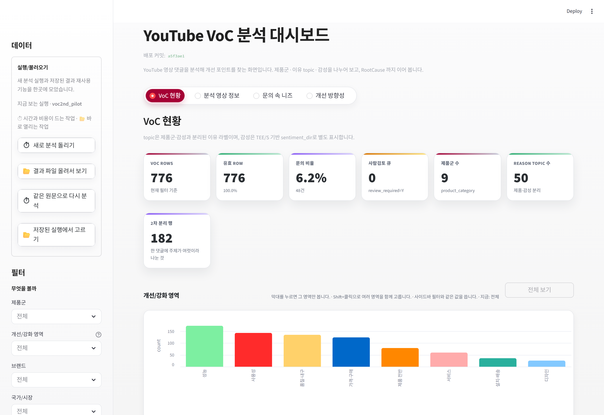
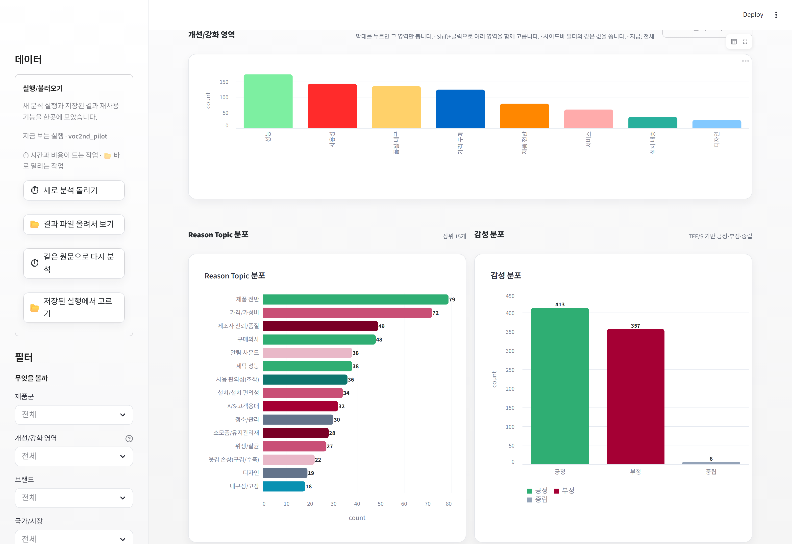
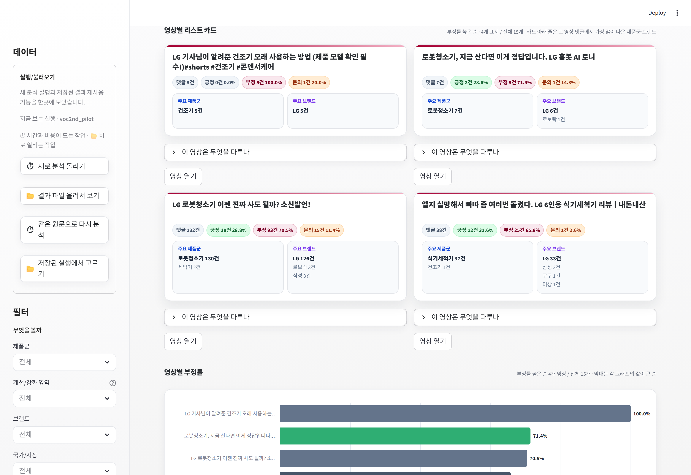
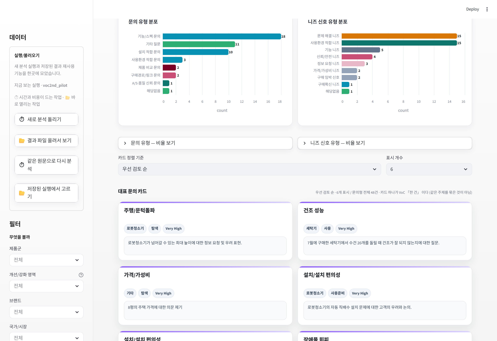
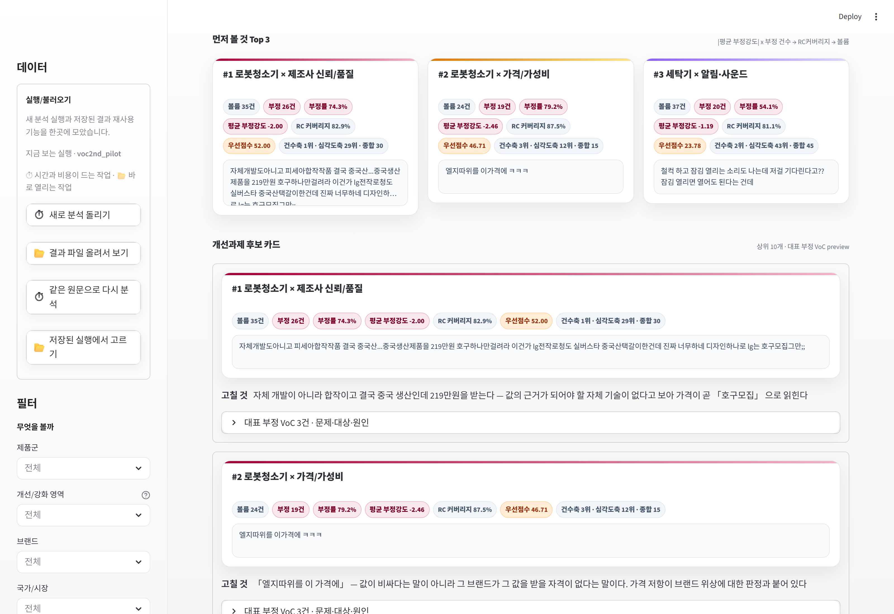

# VoC 65 운영 대시보드 — 사용 설명서

> **이 문서를 읽는 사람** — 대시보드에서 개선 과제를 찾는 총괄
> 기준 2026-08-19 · 배포본 확인 · 화면 구성은 배포 커밋의 코드와 실제 화면으로 확인했습니다
>
> ★ 캡처는 2026-08-20 화면입니다. `캡쳐/` 폴더에 함께 있습니다.
>   다시 찍으려면 대시보드를 띄운 뒤
>   `node scripts/capture_manual_screenshots.mjs 8512 "outputs/사용설명서_캡쳐"`

---

## 0. 어디로 들어가나

```
배포본   Streamlit Cloud · 브랜치 codex/voc-engine-rebuild
로컬     C:\codex_live_merge 에서
         python -m streamlit run streamlit_app.py
```

★★ **`C:\codex` 에서 띄우지 마십시오.**

```
C:\codex_live_merge    브랜치 codex/voc-engine-rebuild   engine.py 4,500줄  ← 정상
C:\codex               브랜치 codex/voc-second-stage     engine.py 1,934줄  ← 옛 엔진
```

두 곳 다 `streamlit_app.py` 가 있고 화면도 똑같이 뜹니다.
그런데 **`C:\codex` 쪽은 옛 엔진이라 분석 결과가 달라집니다.**
2026-08-20 까지 이 문서에 `C:\codex` 로 적혀 있었습니다.

맞게 띄웠는지는 화면에서 확인하십시오 —
제목 아래 **배포 커밋**이 `codex/voc-engine-rebuild` 의 커밋이어야 합니다.

```bash
# 처음 받는 사람
git clone https://github.com/skycloud-maker/youtube-comment-analyzer.git
cd youtube-comment-analyzer
git checkout codex/voc-engine-rebuild
pip install -r requirements.txt
python -m streamlit run streamlit_app.py
```

분석을 직접 돌리려면 `.env` 에 `OPENAI_API_KEY` 와 `YOUTUBE_API_KEY` 가 있어야 합니다.
결과만 볼 때는 필요 없습니다.

**화면 이름은 「VoC 65 운영 대시보드」입니다.**
제목 아래 **배포 커밋**과 **schema 버전**이 늘 적혀 있습니다.

```
★ 무엇을 보고 있는지 헷갈리면 여기부터 보십시오
  66컬럼 v2.9 엔진 출력 전용 화면입니다
```


---

## 1. 화면은 세 덩어리입니다

```
┌──────────────┬──────────────────────────────────────────┐
│  왼쪽        │  가운데                                   │
│  사이드바     │                                          │
│              │   ① 상단 지표 6개                         │
│  데이터 고르기 │   ② 탭 4개                               │
│  필터        │   ③ 탭 내용 (표·차트)                      │
└──────────────┴──────────────────────────────────────────┘
```

---

## 2. 왼쪽 — 무엇을 볼지 고르는 곳

### 2.1 데이터

```
실행/불러오기
   지금 보는 실행 · <실행 이름>      ← 무엇을 보고 있는지 여기 나옵니다
   ⏱ 시간과 비용이 드는 작업  ·  📂 바로 열리는 작업

   ⏱ 새로 분석 돌리기          새로 모으거나 아직 분석 안 한 파일을 분석
   📂 결과 파일 올려서 보기     분석이 끝난 파일을 올려 바로 봅니다
   ⏱ 같은 원문으로 다시 분석    예전 결과에서 원문만 꺼내 다시 판정
   📂 저장된 실행에서 고르기     이 서버에 있는 결과를 골라 바로 봅니다
```

**보통은 「저장된 실행에서 고르기」로 시작합니다.**
파일을 올릴 필요도 없고 바로 열립니다.

★ **⏱ 가 붙은 둘은 OpenAI 를 부릅니다** — 시간과 비용이 듭니다.
  누르기 전에 비용 확인 상자를 체크해야 버튼이 열립니다.
  이미 분석한 것을 다시 보려면 📂 쪽을 쓰십시오.

### 2.2 필터 — 두 층으로 나뉘어 있습니다

```
필터
  무엇을 볼까                ← 대상 범위
     제품군 · 개선/강화 영역 · 브랜드 · 국가/시장
     고객 여정 단계(CEJ) · 감성

  어디까지 볼까              ← 품질 문턱
     판정 충족도  (Very High) (High)  Medium   Low
     ○ 사람 검토가 필요한 행만

  776행 보는 중 · 「무엇을 볼까」 통과 1,185행 · 조건 2개 적용
  [ 필터 초기화 ]
```

두 층은 성격이 다릅니다. 위는 **무엇을 볼지**, 아래는 **어디까지 믿을지**입니다.

### 2.3 판정 충족도 ★ 처음 헷갈리는 곳

```
(Very High) (High)  Medium   Low      ← 앞의 둘이 기본으로 켜져 있습니다
```

**판정이 맞을 확률이 아닙니다.** 그 행에 정보가 얼마나 채워졌는지입니다.

| | 무엇이 들어 있나 |
|---|---|
| Very High | 문제·개선 대상·원인까지 다 있음 |
| High | 감정·노력까지 있음 |
| Medium | 주제만 잡힘 |
| Low | 주제도 못 잡음 |

기본값이 Very High·High 라서 **화면 건수가 데이터보다 적게 나옵니다.**
「데이터는 1,698행인데 화면엔 776행이네?」 하면 여기를 보십시오.
맨 아래 요약에 몇 행이 빠졌는지 적혀 있습니다.

### 2.4 사람 검토가 필요한 행만

```
켜면   사람이 봐야 한다고 표시된 행만 나옵니다
★ 4차 검토를 할 때 씁니다. 평소엔 꺼 둡니다
```

### 2.5 되돌리기

조건을 여러 개 걸었다가 처음으로 돌리려면 **「필터 초기화」** 를 누르십시오.
하나씩 지울 필요 없습니다. 조건이 없으면 버튼이 흐리게 비활성입니다.

**필터를 걸면 아래 지표와 모든 탭이 같이 바뀝니다.**

---

## 3. 가운데 위 — 지표 6개



| 지표 | 무슨 뜻인가 | 이렇게 읽습니다 |
|---|---|---|
| **VOC ROWS** | 지금 필터에 걸린 행 수 | 필터를 바꾸면 이 숫자가 먼저 바뀝니다 |
| **유효 ROW** | 그중 분석 대상인 행 | 제외 행을 뺀 수입니다 |
| **문의 비율** | 질문형 VoC 비율 | 높으면 **안내가 부족**하다는 뜻입니다 |
| **재확인 필요 수** | `review_required=Y` | 사람이 봐야 하는 행 |
| **제품군 수** | 몇 개 제품군이 걸렸나 | 필터 확인용 |
| **REASON TOPIC 수** | 몇 종의 주제가 나왔나 | 다양성 확인용 |

```
★ 「REASON TOPIC」 이라고 부르는 이유
  topic 은 「제품군」 이나 「감성」 이 아니라 「왜 그런 말이 나왔는가」 를 가르는 라벨입니다.
  감성은 sentiment_dir 로 따로 표시됩니다
```

---

## 4. 탭 4개 — 무엇을 볼 때 어디로

```
VoC 현황 → 분석 영상 정보 → 문의 속 니즈 → 개선 방향성
전체 그림    어디서 나왔나    무엇을 묻나    무엇을 고칠까
```


### ■ 탭 1 · VoC 현황

**전체 그림을 볼 때.** 처음 열면 여기입니다.

```
개선/강화 영역        9개 영역으로 먼저 좁혀 봅니다 (넓적한 막대 하나)
                     ★ 막대를 누르면 그 영역으로 필터가 걸립니다
                       여러 개 고르려면 Shift 를 누른 채 클릭
Reason Topic 분포     어떤 주제가 몇 건인가
감성 분포             긍정 / 부정 / 중립

개별 VoC 개선 포인트 체크
  ▸ RootCause 등급(L0~L3)으로 거르기
  ▸ 2차 분리 행만 보기
  ▸ 행을 고르면 아래 「RootCause 상세」 에서 그 VoC 를 읽습니다
```



```
★ 여기서 이상하면 아래 탭도 다 이상합니다
  「제품군 수 1」 인데 여러 제품을 보고 싶었다면 필터부터 고치십시오
```

**RootCause 등급이란**

| | 무엇이 원문에 있나 |
|---|---|
| L3 | 문제·개선 대상·원인이 모두 있다 |
| L2 | 원인 서술만 없다 |
| L1 | 개선 대상이 없다 |
| L0 | 원문에 결핍 서술이 없다 |

### ■ 탭 2 · 분석 영상 정보

**어느 영상이 반응을 만들었나.**

```
최소 댓글 수          기본 5. 댓글이 적으면 비율이 크게 흔들립니다
                     ☐ 댓글 5건 미만인 영상만 보기  ← 잘려 나간 것을 따로 봅니다

영상별 리스트 카드     정렬 기준과 표시 개수를 고를 수 있습니다
                     카드 아래 두 칸 = 주요 제품군 / 주요 브랜드
영상별 부정률·긍정률·문의율   카드와 같은 개수만큼 그립니다
영상별 집계 체크       전체 영상을 담은 표. 행을 고르면 아래에서 상세를 읽습니다
```



```
★ 문의율은 감성과 별개입니다.
  「긍정인데 문의율이 높은 영상」 = 관심은 많은데 설명이 부족한 영상입니다

★ 댓글 1~2건짜리 영상은 부정률이 100% 로 뜨기 쉽습니다.
  그래서 최소 댓글 수가 기본 5 입니다. 그 아래 영상은 옆 상자로 따로 봅니다
```

### ■ 탭 3 · 문의 속 니즈

**고객이 무엇을 몰라서 묻는가.**

```
문의 유형 / 니즈 신호 유형   두 그래프 + 비율 보기(접이식)
대표 문의 카드               정렬 기준과 표시 개수를 고를 수 있습니다
문의형 VoC 체크              문의 유형으로 거를 수 있고,
                            행을 고르면 아래에서 원문과 판정 근거를 읽습니다
```



```
★ 이 탭이 개선 과제로 바로 이어지는 경우가 많습니다.
  질문이 반복된다 = 그 정보를 우리가 안 알려 줬다는 뜻이기 때문입니다
```

### ■ 탭 4 · 개선 방향성 ★ 결론이 나오는 곳

```
군집 = product_category × topic
정렬 축을 고릅니다   우선순위 점수 (기존) · 종합(두 축 순위합) · 건수축 · 심각도축
                    ★ 고른 축 순서대로 카드가 나열됩니다

priority_score = |평균 부정 강도| × 부정 건수
RC 커버리지     군집 VoC 중 Root Cause 가 정의된 비율

먼저 볼 것 Top 3
개선과제 후보 카드   상위 10개
                    ▸ 대표 부정 VoC / Root Cause 근거   ★ 실제 댓글을 봅니다
전체 개선과제 후보   ⬇ 내려받아서 봅니다 (화면에는 표를 두지 않습니다)
                    받는 파일에 순위 · 구분(Top 10 / 그 밖) · 정렬축이 들어갑니다
                    ★ 정렬축을 바꾸면 Top 10 명단도 바뀝니다
                    ▸ 🧪 AI 서술 생성 (실험)   상위 군집을 한국어로 압축 요약
```



---

## 4.5 표를 통째로 받고 싶을 때

각 탭의 표 아래에 **「⬇ 통째로 받기」** 버튼이 있습니다.

```
분석 영상 정보 탭   ⬇ 영상별 집계 통째로 받기
문의 속 니즈 탭     ⬇ 문의형 VoC 통째로 받기
개선 방향성 탭      ⬇ 전체 개선과제 후보 내려받기
```

표 오른쪽 위의 작은 ⬇ 는 **보이는 칸만** 내려줍니다.
아래 버튼은 **화면에서 숨긴 칸까지 전부** 줍니다.

★ 여기서 받는 파일은 **사용자명·이메일·링크가 가려진 판본**입니다.
  원문 그대로가 필요하면 번들(전체_최종_번들.xlsx)을 쓰십시오.

## 5. ★ 개선과제 우선순위를 읽을 때 조심할 것

**점수 한 축만 보면 성격이 정반대인 둘이 같은 자리에 섭니다.**

```
   로봇청소기 내구성/고장    3건 · 평균 -3.67  →  11.0
   세탁기 알림·사운드      86건 · 평균 -0.52  →  11.0

   앞은 「세 명이 크게 화났다」
   뒤는 「여든여섯 명이 조금씩 불편하다」
```

```
★ 화면에서는 이렇게 보십시오

  ① 점수 순으로 훑되, 옆의 n(건수) 과 mean_neg(평균 강도) 를 같이 봅니다
  ② 건수가 적고 강도가 센 줄은 「소수의 심각한 문제」 입니다.
     건수가 적다고 무시하지 마십시오
  ③ 건수가 많고 강도가 약한 줄은 「많은 사람의 잔불편」 입니다.
     둘은 다른 과제입니다
```

**두 축으로 정렬한 표가 번들 옆에 따로 있습니다.**

```
_판독패키지/_결과/master_final/개선우선순위_두축.csv
   건수축_순위 · 심각도축_순위 · 봐야_하는가
```

> 화면에 두 축을 넣는 것은 **다음 개발 항목**입니다.
> 그때까지는 이 CSV 를 같이 보십시오.

---

## 6. RC 커버리지가 낮으면

```
RC 커버리지 = 그 군집에서 「무엇이 문제인가」 가 적힌 비율

낮다  →  건수는 있는데 원인이 안 적혔다는 뜻입니다
        개선 과제로 옮기기 전에 실제 댓글을 직접 보십시오
        (▸ 대표 부정 VoC / Root Cause 근거)
```

---

## 7. 자주 겪는 일

| 이런 일이 | 왜 그런가 |
|---|---|
| 화면 건수가 데이터보다 적다 | **판정 충족도** 가 Very High·High 만 켜져 있습니다. 사이드바 맨 아래 요약에 몇 행이 빠졌는지 나옵니다 |
| 제품군이 하나만 나온다 | 왼쪽 **제품군 필터** 를 확인하십시오 |
| 표가 비어 있다 | 필터가 너무 좁습니다. 「필터 초기화」 를 누르십시오 |
| 어느 데이터를 보는지 모르겠다 | 제목 아래 **배포 커밋 · schema** 와 사이드바 **스냅샷** 을 보십시오 |
| 숫자가 번들 엑셀과 다르다 | 필터가 걸려 있거나 스냅샷이 다른 것입니다. 둘 다 확인하십시오 |
| topic_group 으로 묶어 보고 싶다 | **아직 화면에 없습니다.** 번들 엑셀의 `topic_group` 열을 쓰십시오 |

---

## 8. 아직 화면에 없는 것 — 다음 개발 항목

```
① topic_group 필터
     주제 56종이 흩어져 보입니다. 상위 9종으로 묶어 보는 필터가 필요합니다

② 개선 우선순위 두 축
     지금은 한 축(|강도|×건수) 뿐입니다

★ 둘 다 데이터에는 이미 들어 있습니다. 화면에만 안 붙었습니다
  1차 엔진 동결 규율에 걸려 별도 판단이 필요한 작업입니다
```

---

## 곁들여 읽을 것

```
62_4차검토_및_번들해설.md                     번들의 각 시트가 무엇인지
15_VoC_데이터사전_스키마_v3.2_90컬럼.xlsx      칸 하나하나의 정의
_설계서/16_VoC_분석엔진_재현설계서_v13.docx     §8.1 개선 우선순위 두 축 · §9 어디까지 믿는가
```

---

## ★ 결과를 회사 밖으로 보낼 때

이 화면과 내려받는 파일에는 **고객이 쓴 댓글 원문**이 들어 있습니다.

**화면에서 이미 지우고 있는 것**
- 댓글 작성자 이름(`@호출명`) → `@***`
- 이메일 · 링크

**여전히 남아 있어 주의할 것**
- 「분석 영상 정보」 표의 **영상 링크**
- 카드·표의 **댓글 내용** — 판정을 확인하려면 필요해서 남겨 둡니다

### 회사 밖으로 보낼 파일은 이렇게 만드십시오

산출물 내려받기 안에 **「회사 밖으로 보낼 때」** 자리가 있습니다.

```
회사 밖으로 보낼 때
  영상 링크·아이디·댓글 작성자 이름을 지운 판본을 만듭니다.
  댓글 내용은 그대로 남습니다.

  [ 안전한 판본 만들기 ]  → 확인이 끝나면 [ 안전한 판본 내려받기 ]
```

- **다 지워졌는지 확인해야만 파일이 만들어집니다.** 확인을 통과하지 못하면
  파일을 내주지 않습니다.
- **「결과 파일 올려서 보기」 에서 쓰면** 올리신 파일에 든 것을 그대로 씁니다 —
  2차 판독으로 고친 내역이 들어 있는 번들을 올렸다면 그것도 함께 담깁니다.
- **「저장된 실행에서 고르기」 에서 쓰면** 분석 결과만 담깁니다.

★ **그냥 받은 파일을 그대로 회사 밖에 내지 마십시오.**
  거기에는 영상 링크와 댓글 원문이 전량 들어 있습니다.
  자세한 기준은 `참고/65_개인정보_처리_기준_및_제출문안.md` 를 보십시오.

---

## 파일 내려받기 — 무엇을 받아야 하나

```
최종 데이터 받기      이 분석의 결과물입니다. 웬만한 일은 이것 하나면 됩니다
표만 받기 (CSV)       엑셀 말고 다른 프로그램에 넣을 때
표만 받기 (JSONL)     프로그램으로 읽을 때 쓰는 형식

잘 안 될 때
  [ 기록 묶음 받기 ]   받아서 파일 그대로 총괄나 AI 에게 주고
                      「이 분석이 잘 안 됐는데 원인을 찾아 달라」 고 하시면 됩니다.
                      열어 보실 필요는 없습니다
```
